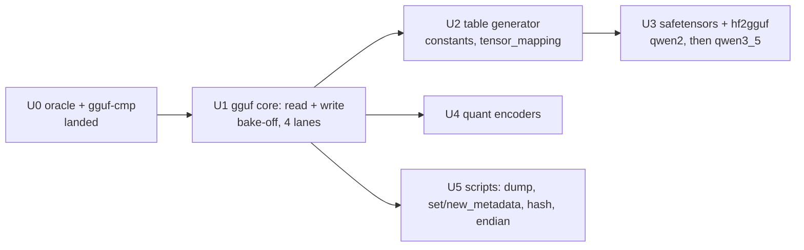

# mojo-gguf plan (2026-10-12)

Goal: llama.cpp's HF-to-GGUF converter, gguf-py library, gguf-py scripts and quantizer, in Mojo, each unit
proven against the pinned llama.cpp output (`1744c6bde`, `tools/oracle.sh`). Tables are generated from the
Python source, not hand-ported; procedural code is ported unit by unit, each with a byte gate it cannot edit.

## Upstream size (wc -l at f9a95ae, 2026-10-12)

| piece | LOC | route |
|---|---|---|
| `convert_hf_to_gguf.py` + `conversion/` (98 files) | 312 + 23,741 | U2 tables + U3 per-arch transforms, archs we serve only |
| gguf-py core (`constants` 6,292, `tensor_mapping` 3,028, `gguf_writer` 1,734, `quants` 1,378, `vocab` 940) | 15,150 | U2 generated; U1 reader/writer |
| gguf-py scripts (GUI 1,621 skipped) | 2,716 | U5 |
| `ggml-quants.c` 5,639, `llama-quant.cpp` 1,520, `quantize.cpp` 668, `imatrix.cpp` 2,049 | 9,991 | U4 (port from C, not from `quants.py`) |

## Oracle baseline (qwen2.5-0.5b-instruct, CPU, `tools/mkoracle.sh`)

| step | wall | peak RSS | output |
|---|---|---|---|
| `convert_hf_to_gguf.py --outtype bf16` | 17.00 s | 2.31 GB | 994 MB |
| `convert_hf_to_gguf.py --outtype q8_0` | 6.12 s | 2.10 GB | 531 MB |
| `llama-quantize --pure` Q8_0 / Q4_0 / Q4_K / Q6_K / Q2_K / Q2_0 / TQ1_0 / TQ2_0 | 0.74-1.38 s | 0.92-1.03 GB | 145-531 MB |

Converter q8_0 (Python `quants.py`) and `llama-quantize` Q8_0 (C) carry identical tensor bytes in a different
tensor order (`gguf-cmp`: PASS same-content, order differs).

## Units and gates

Every gate runs `tools/gguf-cmp.py` (self-test `tests/gguf-cmp-selftest.sh`) or the stated check. A unit is
READY only on a committed sha whose gate passes on a clean worktree.

| unit | deliverable | gate |
|---|---|---|
| U1 | `src/gguf/` package (reader: header, all KV types incl. nested arrays, tensor infos, alignment; writer) + CLI `gguf-rewrite IN OUT` | `tests/u1-gate.sh`: identical-bytes on the 10 qwen25 oracle files and the Flash-Next IQ1_M shard 1 (10.9 MB, tokenizer arrays); wall + peak RSS on the bf16 file recorded |
| U2 | `tools/gen-tables.py` (reads pinned gguf-py) -> `src/gguf/consts.mojo`, `src/gguf/tensor_map.mojo` | regenerate is byte-identical; Mojo test compares every enum value and mapping against a JSON dump from gguf-py |
| U3 | `src/st/` safetensors reader (mmap) + `hf2gguf` for Qwen2, then Qwen3_5 (Qwythos-9B) | gguf-cmp PASS against `bf16.gguf` and `q8_0-py.gguf` (same-content minimum, identical-bytes target); wall + RSS vs the 17.00 s / 2.31 GB baseline |
| U4 | `quantize` CLI, `--pure TYPE` for Q8_0 Q4_0 Q4_K Q6_K Q2_K Q2_0 TQ1_0 TQ2_0 | gguf-cmp per type against the oracle `TYPE.gguf` |
| U5 | dump, set_metadata, new_metadata, hash, convert_endian | `mojo-port verify` style: `tests/cases.txt` through the Python script and the Mojo binary, stdout + exit code equal |

Gap: qwen35moe and qwen4exp have no HF safetensors on this box (GGUF only), so U3 cannot be gated on them yet.

## Lane bake-off (U1)

Same brief (`docs/briefs/u1.md`), same gate, one worktree per lane (`lane-u1-<lane>`):
codex `gpt-6-luna`, deepseek via AgentJack, claude sonnet, local model via `baro-serve` + omp.
Score per lane: gate PASS count (of 11), wall clock to READY, LOC, repair rounds, orchestrator nudges,
rewrite wall + RSS on the 994 MB file. Later units go to the winner; decorrelated second writer for U3/U4
if two lanes pass.
